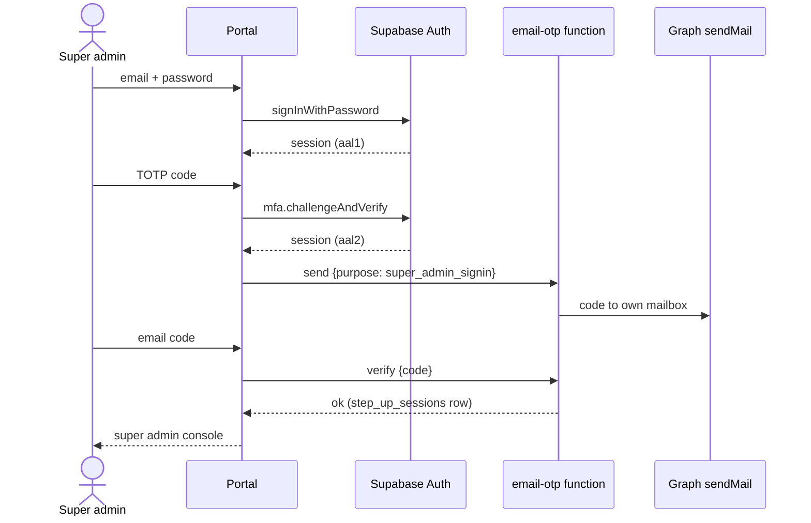
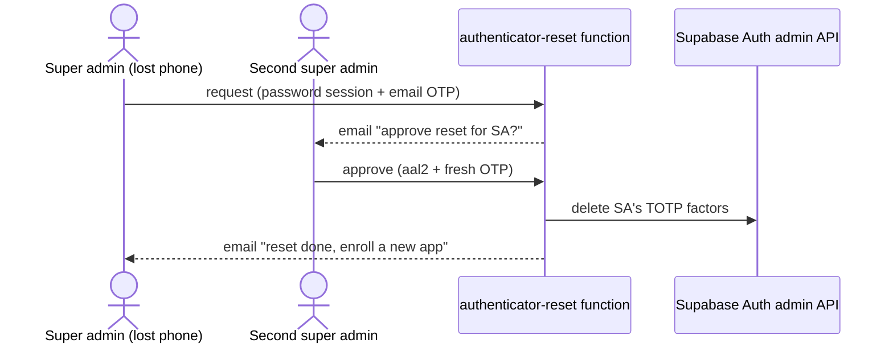
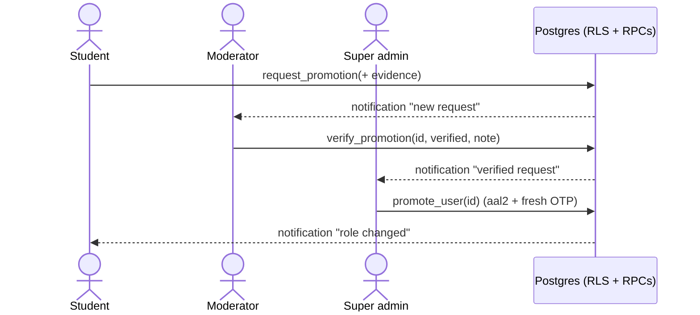

# Spec: Role-based authentication, super-admin email OTP, moderator verification

Status: proposal, not implemented. Date: 2026-10-31.

## 0. Baseline and assumptions

- **Admin authenticator (unchanged):** coordinator (`admin`) signs in with password, then a TOTP code from an authenticator app (Supabase Auth MFA, `aal2`). First sign-in enrolls the app (QR + setup key). DB helpers `is_admin()` / `is_super_admin()` require `auth.jwt()->>'aal' = 'aal2'`. Source: branch `feat/email-otp-2fa-and-ui-fixes` (`MfaGate`, migration `20261029000200`).
- Decided 2026-10-31: the admin authenticator is kept; the emailed sign-up code is removed ("Confirm email" off).
- Services already in use, no new providers: Supabase Auth (password, TOTP MFA), Postgres RLS, Supabase Storage, Edge Functions, Microsoft Graph `sendMail` for email (Send Email hook). Cloudflare Turnstile for CAPTCHA.
- Placeholders are marked `[TBD: …]`.

## 1. Roles and permissions

| Role | Assigned by | Second factor at sign-in | Can do |
|---|---|---|---|
| `student` | sign-up (default) | TOTP (new, section 3) | own drafts, submit, resubmit, request promotion |
| `moderator` (new) | super admin | TOTP | read promotion requests + attached evidence; approve / reject verification. No role changes, no application review |
| `admin` (coordinator) | super admin | TOTP (**unchanged**) | review applications, request corrections, approve |
| `super_admin` | SQL editor only | TOTP **+ email OTP** (section 2) | change roles, reset passwords, reset another user's authenticator, telemetry, audit log |

Rules:
- Role changes stay super-admin only (existing trigger). A moderator verifies; a super admin promotes (two-person rule).
- No user acts on their own request (verify, promote, reset).
- Every privileged helper checks the role **and** `aal2`; super-admin helpers also check email-OTP freshness (2.3).

Promotion paths `[TBD: confirm]`: `student → moderator`, `student → admin`. "Higher access level" = any role above `student`.

## 2. Super admin: email OTP

### 2.1 When it is asked
- Every super-admin sign-in, after password and TOTP: one email OTP. Result: "step-up verified" for that session.
- Freshness window for sensitive actions (role change, authenticator reset, password reset): 15 minutes. Older → ask a new OTP. `[TBD: window]`

### 2.2 Code rules
- 6 digits, CSPRNG, uniform (rejection sampling).
- Stored as hash only (`HMAC-SHA256(server_pepper, code)`); pepper in Edge Function secrets.
- Expires in 10 minutes; single use; 5 wrong attempts kill it; a new code invalidates the old one.
- Send limit: 1 per 60 s, 5 per hour per user.
- Email only to the account's own `@muj.manipal.edu` address, via the existing Graph sender. Code never logged.

### 2.3 Data model
```
email_otp_challenges
  id            uuid pk
  user_id       uuid fk auth.users
  session_id    uuid            -- auth.jwt()->>'session_id'
  purpose       text            -- 'super_admin_signin' | 'authenticator_reset'
  code_hash     text
  expires_at    timestamptz
  attempts      int default 0
  consumed_at   timestamptz null
  created_at    timestamptz

step_up_sessions
  session_id    uuid pk
  user_id       uuid
  verified_at   timestamptz
```
RLS: no direct client access to either table; only SECURITY DEFINER functions / Edge Functions.

Helper: `is_email_otp_fresh(window interval)` → true if `step_up_sessions.verified_at` for the current `session_id` is within the window. `is_super_admin()` becomes `role = super_admin AND aal2 AND is_email_otp_fresh('12 hours')`; sensitive RPCs also check `is_email_otp_fresh('15 minutes')`.

### 2.4 Endpoints
| Endpoint | Caller | Purpose |
|---|---|---|
| `POST /functions/v1/email-otp/send` `{purpose}` | signed-in super admin (aal2) | create challenge, email code |
| `POST /functions/v1/email-otp/verify` `{purpose, code}` | same session | check hash; on success write `step_up_sessions` |

Responses never say whether the account exists; errors: `invalid_or_expired`, `rate_limited`.

### 2.5 Sign-in sequence


### 2.6 Authenticator reset via OTP (lost phone)
A single factor (email) must not silently replace TOTP. Reset therefore needs:
1. Password sign-in (aal1).
2. Email OTP, `purpose = authenticator_reset`.
3. **Approval by a second super admin** (aal2 + fresh OTP), or, if only one super admin exists, a **24-hour delay** `[TBD: choose]`.
4. Then the Edge Function (service role) calls the Auth admin API to delete the user's TOTP factors; next sign-in re-enrolls.
5. Notify all super admins by email; write audit row; end the user's other sessions.

```
authenticator_reset_requests
  id, user_id, requested_at, otp_verified_at,
  approved_by uuid null, approved_at null, executes_after timestamptz,
  status ('pending'|'approved'|'executed'|'cancelled')
```
Endpoints: `POST /functions/v1/authenticator-reset/request`, `/approve` (other super admin), `/cancel` (the owner, from any signed-in session).



Admins, moderators and students who lose their phone: a super admin resets them (step 4 only), after identity check `[TBD: in person / ID]`.

## 3. Authenticator for students

Same mechanism as admins; the admin path is not touched.

1. **UI:** the route guard already shows `MfaGate` when `mfaStatus` is `enroll` or `challenge`. Change the status rule from "admin or super admin" to "any signed-in role in `MFA_REQUIRED_ROLES`" (config list). Admin behaviour identical.
2. **DB:** add `is_aal2()` to student write policies: `applications` insert/update, document upload, submit/resubmit RPCs. Reads of own data may stay `aal1` `[TBD]`.
3. **Rollout:** flag `student_mfa_mode` in `app_settings`: `off` → `optional` (enroll prompt, skippable) → `required`. Students with existing drafts keep them; they enroll at next sign-in.
4. **Recovery:** section 2.6 step 4 (super admin reset). Optional later: one-time recovery codes `[TBD]`.
5. **Supabase setting:** `[auth.mfa.totp] enroll_enabled = verify_enabled = true` (already used for admins).

## 4. Moderator role and patent verification

### 4.1 Role
`ALTER TYPE app_role ADD VALUE 'moderator'`; helper `is_moderator()` (role + `aal2`).

### 4.2 What is verified
The user's evidence that justifies promotion, one of:
- an application in this portal with status `approved_next_stage` owned by the user, or
- an external patent / application number + uploaded proof (PDF) `[TBD: accepted types]`.

### 4.3 Data model
```
promotion_requests
  id              uuid pk
  user_id         uuid fk profiles
  requested_role  app_role         -- not 'student', not 'super_admin'
  application_id  uuid null fk applications
  patent_number   text null
  evidence_path   text null        -- storage: promotion-evidence/{user_id}/{id}.pdf
  status          text             -- 'pending' | 'verified' | 'rejected' | 'promoted' | 'withdrawn'
  moderator_id    uuid null
  moderator_note  text null
  verified_at     timestamptz null
  promoted_by     uuid null
  promoted_at     timestamptz null
  created_at      timestamptz
```
RLS:
- owner: insert own (`status = 'pending'`), read own, withdraw own pending.
- moderator: read all pending/verified; update `pending → verified|rejected` with a note; never own rows.
- super admin: read all; update `verified → promoted` (same transaction changes `profiles.role`).
- Storage bucket `promotion-evidence`: owner writes own folder; moderator and super admin read.
- One open request per user (partial unique index on `user_id` where status in `pending, verified`).

### 4.4 Endpoints (RPCs)
| RPC | Caller | Effect |
|---|---|---|
| `request_promotion(role, application_id?, patent_number?, evidence_path?)` | student (aal2) | creates `pending` |
| `verify_promotion(id, decision, note)` | moderator (aal2) | `verified` or `rejected`; notifies owner |
| `promote_user(id)` | super admin (aal2 + fresh email OTP) | requires `verified`; sets role, `promoted`; audit + notify |
| `withdraw_promotion(id)` | owner | `withdrawn` |

### 4.5 Sequence


## 5. Audit

Write a row for: OTP sent / verified / failed, reset requested / approved / executed, promotion requested / verified / rejected / promoted, role changed. Fields: actor, target, action, request id, timestamp. No codes or evidence content.

## 6. Migration order

1. `moderator` enum value (own migration; enum values commit before use).
2. Tables + RLS: `email_otp_challenges`, `step_up_sessions`, `authenticator_reset_requests`, `promotion_requests`; storage bucket.
3. Helpers: `is_moderator()`, `is_email_otp_fresh()`; update `is_super_admin()`.
4. Edge Functions `email-otp`, `authenticator-reset`; secrets: OTP pepper, Graph credentials (existing).
5. Student MFA flag `off`, then `optional`, then `required`.

## 7. Tests to add

- Super admin without fresh email OTP: role change, reset, telemetry refused.
- OTP: expiry, single use, 5-attempt lockout, resend invalidates old, rate limit.
- Reset: cannot execute without second approval / before delay; owner can cancel.
- Moderator: cannot verify own request, cannot change roles, cannot read applications.
- Promotion: `promote_user` refuses non-`verified`; role and request change in one transaction.
- Admin TOTP flow: unchanged (existing tests stay green).

## 8. Open questions

- `[TBD]` Email OTP at every super-admin sign-in, or only before sensitive actions?
- `[TBD]` Single super admin: 24 h delay acceptable for resets?
- `[TBD]` Which roles can be requested via promotion?
- `[TBD]` Student MFA: required for all writes, or only for submit?
- `[TBD]` Accepted external patent evidence and how moderators check it.
